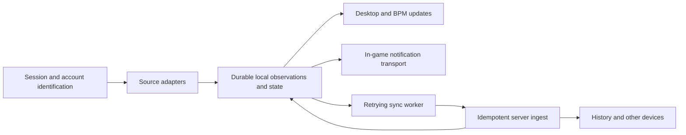

# Achievement tracking overhaul proposal

Status: core approved by owner on 2026-11-05; implementation is uncommitted and awaits device/database validation.
Current behavior is documented in `docs/map/achievements.md` and `../drop-server/docs/map/achievements.md`.
The original design below also includes follow-on work. Managed RA event bridging, additional storefronts,
graphics hooks, Linux/Gamescope popup transport, resumable cross-device history and receipt retention remain open.
The core includes a durable scoped journal, source watchers, native Steam fixture reader, v2 server receipts,
progress/mode state, reset epochs, desktop/BPM status and an opt-in Windows popup prototype. No real-game coverage,
latency or fullscreen result is claimed.

## Outcome and scope

Drop should detect an achievement as soon as its source exposes it, save that observation durably,
update the local UI and notify the player, then sync it to the Drop server. Server availability must
not decide whether a locally observable unlock can be captured. Cover desktop and Big Picture on
Windows, Linux and Steam Deck, including RetroAchievements and standalone Windows/Steam builds.

The owner requested that system changes be run by them first. This document is the approval artifact.
At the audit stage, no runtime code, game files, OS settings, installed helpers, credentials or database schemas changed.
The subsequently approved implementation changes are recorded in the current achievement maps and task notes.
No commits, releases or deployments are part of this work.

Universal coverage cannot be promised from an achievement list alone. A specific game build must
actually emit accessible unlock information. A DRM-free build may omit the Steam achievement calls
present in its Steam release. Some games expose data only after a save or on exit. Such a build needs
a validated game adapter or runtime integration before Drop can claim real-time coverage.

## Problems confirmed before the core rebuild

These are findings from the pre-rebuild source, not claims that a particular installed game reproduced each failure.
Line references below describe that original source and can differ from the rebuilt working tree.

| Finding | Owning source | Effect |
|---|---|---|
| One mutually exclusive mode, with RA taking priority whenever linked | `src-tauri/remote/src/achievements.rs:20`, `src-tauri/remote/src/achievements.rs:507` | A game link selects a provider without proving it matches the running build. |
| An initial config failure without a usable cache becomes None mode for the session | `src-tauri/remote/src/achievements.rs:584` | Connection recovery does not restart detection. |
| Fixed 15-second cadence, with the initial immediate interval tick consumed | `src-tauri/remote/src/achievements.rs:615` | Local writes are noticed late; remote provider propagation adds further delay. |
| Local notifications come from the successful server report response | `src-tauri/remote/src/achievements.rs:392` | A detected local unlock has no immediate Drop popup while the server is unavailable. |
| Every successfully submitted name is marked known, including unmatched definitions | `src-tauri/remote/src/achievements.rs:423` | Missing definitions suppress retry for the remainder of the session. |
| There is no durable event outbox in this achievement pipeline | `src-tauri/remote/src/achievements.rs:313`, `src-tauri/remote/src/achievements.rs:392` | Recovery depends on rediscovering the source files, not replaying saved observations. |
| Client submits the entire detected batch; server accepts at most 500 entries | `src-tauri/remote/src/achievements.rs:405`, `../drop-server/server/api/v1/client/game/[id]/achievements-report.post.ts:18` | A large historical import can repeatedly reject rather than make progress. |
| The Steam reader examines only librarycache JSON vecHighlight | `src-tauri/remote/src/goldberg/crackers.rs:347` | It does not enumerate a complete native Steam stats snapshot; completeness and freshness are unproven. |
| Steam source discovery walks every user directory and merges unlocks by name | `src-tauri/remote/src/goldberg/crackers.rs:395`, `src-tauri/remote/src/goldberg/crackers.rs:442` | Another Steam account's achievements can enter the current player's result. |
| Invalid or missing local timestamps become the current time | `src-tauri/remote/src/achievements.rs:349` | Historical unlocks can look new and can cross a reset boundary incorrectly. |
| RA reads website progress, combining DateEarned and DateEarnedHardcore into one unlock | `../drop-server/server/internal/achievements/retroachievements.ts:181`, `../drop-server/server/internal/achievements/retroachievements.ts:254` | No immediate emulator event path and no separate hardcore upgrade history. |
| Runtime item types hold unlock booleans, without per-achievement measured progress | `src-tauri/remote/src/achievements.rs:31`, `src-tauri/remote/src/goldberg/achievements.rs:28` | Overall completion percentage exists, but live counters/challenges are not represented. |
| The toasts are Vue elements inside the Drop window | `main/components/AchievementToast.vue:5`, `main/components/bigpicture/BpmAchievementToastHost.vue:1` | They do not provide a general notification surface above a running game. |
| BPM queues only five further popups; dedup expires after ten seconds | `main/components/bigpicture/BpmAchievementToastHost.vue:26`, `main/composables/achievements/toast.ts:31` | Burst presentation and retry dedup need a persistent policy. Unlock storage is separate from this queue. |
| Poller exit cancellation and post-exit server sync are separately spawned | `src-tauri/process/src/process_manager/exit.rs:99` | Delayed final writes and competing RA sync paths need explicit lifecycle tests. Actual lost unlocks here are not proven. |

The shared server writer already enforces unique user/achievement unlocks and checks resets, including
concurrent insert handling. Keep those protections in `../drop-server/server/internal/achievements/repo.ts`.
This should be an incremental replacement behind a compatibility boundary, preserving useful parsers.

## Proposed architecture

### 1. One tracking service, multiple source adapters

Keep the core in the existing Rust client. Each adapter probes a session, returns capabilities and
diagnostics, reads a baseline, watches changes, and performs recovery scans. Separate the achievement
set from the file format that happens to store it. Goldberg and native Steam can describe the same
Steam set, while RA is a separate set. Merge only explicitly mapped equivalent achievements.

Select sources using the actual launch context: Drop user/server, install/version, executable,
process tree, provider game ID, provider account, and actual Wine prefix. Use the launcher's active
account, not every account ever found on disk. An ambiguous identity produces a visible configuration
problem. Capture a pre-launch baseline so old achievements import quietly and new ones notify.

Watch selected directories before process launch, including a parent when the file does not yet
exist. Handle create/rename/replace, truncation, partial writes, file locks and watcher overflow.
Debounce briefly, retry transient reads, and retain the last good snapshot. Use bounded fallback scans
for active sources; start with a one-second interval and measure CPU/I/O. Never continuously rescan
all possible save roots. A parsing failure must not erase known progress or look like an empty set.

Use a supervised lifecycle for launchers/child processes, source reconnection, delayed exit writes and
app shutdown. Resume pending sync on Drop startup even when the game is no longer running. Existing
incognito semantics remain unchanged unless the owner separately chooses otherwise.

### 2. Durable local events, then independent server sync

Use a new, explicitly versioned achievement journal/state store under Drop's data directory rather
than changing install files. Start with atomic per-event records and a rebuildable state index, with
bounded compaction and crash recovery. Partition by server and Drop user; bind each observation to
its originating provider account. Never submit one account's queued events after signing into another.

An observation contains a stable event ID, session/device identity, achievement-set identity, source,
external achievement ID, mode, event kind, original occurrence time if known, observation time, and
timestamp quality. Progress events also carry current/target values when exposed. Unknown achievement
IDs remain queued pending definition repair. Unknown unlock times stay unknown, rather than becoming
fabricated acquisition times.

Coalesce high-frequency progress into the latest durable value per achievement/source, preserving
source ordering and legitimate decreases. Challenge indicators are transient state. Unlocks and mode
upgrades remain durable events and are never discarded as progress noise.

Write the event before presenting a new-unlock notification. Update local state immediately and
show pending server sync when necessary. Import old snapshots quietly. Persist the notification
decision to suppress replay popups; coalesce historical bursts into a summary. Do not promise exactly
once visual delivery across a crash between displaying a popup and persisting its receipt.

The worker sends bounded batches and retries network failures, 429 responses and retryable server
errors with backoff and jitter. The response acknowledges each event as accepted, duplicate, awaiting
definitions, rejected by reset, or invalid with a reason. Only terminal dispositions retire an event;
unmatched IDs are not success. Reconcile missed server events using a resumable change cursor.

### 3. Provider coverage and feasibility gates

| Source | Proposed integration | Coverage boundary / proof required |
|---|---|---|
| Goldberg/GBE, SSE and existing compatible Windows formats | Keep supported readers, add fixtures, account-aware resolution and directory watchers. Read stats/progress where actually present. | A real runtime write is required. Discover the loaded build's save directory, including nested DLL directories and Proton prefixes. |
| Native Steam games | Implement and validate complete local Steam stats snapshots for the selected account; watch their actual writes. Use linked-account Web API reads for history/reconciliation where permitted. | Local caches are undocumented and can change. Unknown formats must report unsupported. Website reads are delayed reconciliation, not guaranteed instant detection. |
| RetroAchievements in stock RetroArch | Validate runtime game/hash/core/account status; use native RetroArch popups immediately. Evaluate its actual local logs for unambiguous event capture, with website reconciliation as fallback. | Stock logs are not assumed to contain stable achievement IDs, progress or an external event API. Validate the bundled version, not just current upstream. |
| RetroAchievements with complete live Drop progress | If stock interfaces are insufficient, add a small maintained event bridge at the emulator's existing rcheevos callbacks, exported through session-scoped local IPC. | This requires an owner-approved managed emulator build. The existing emulator runtime remains responsible for evaluation and official RA submissions. |
| Standalone Windows builds outside those formats | Add read-only save/log adapters for validated builds; support a small local event interface for games/mods that can publish events. | A Steam store page does not establish that a standalone build exposes achievements. Game/build-specific work may be required. |
| GOG, Epic, Xbox PC and other launchers | Extend the same adapter boundary after validating an accessible local or account-backed source for each. | Separate follow-on scope. Their developer SDKs are not universal cross-game unlock listeners. Xbox is also the experience benchmark, not an assumed initial dependency. |

Do not treat Steamworks callbacks as a public subscription to arbitrary other games. They operate
in the relevant game's SDK context. Likewise, moving achievement definitions into a folder cannot
create gameplay events that a build never emits. A deeper runtime integration is a separate per-build
decision, not a silent generic DLL replacement or memory scan.

For RA, preserve hardcore and softcore observations independently, handle a later hardcore upgrade,
and capture measured progress/challenges when the runtime exposes them. Local observations can be
shown as pending confirmation; official RA credits and rankings remain dependent on RA's accepted
state. Drop's queue cannot manufacture official offline/hardcore awards. Hash, emulator capability,
token expiry, mode and service failures must be distinct. Do not run a second memory evaluator beside
RetroArch just to obtain notifications. Add emulator adapters individually for other RA emulators.

### 4. In-game notifications are a separate feature

First reuse a game's/emulator's native achievement popup where available and avoid duplicate Drop
popups. Preserve Drop's activity/history and desktop/BPM UI in all cases.

For Drop-specific notifications above games, prototype a non-activating native overlay for windowed
and borderless Windows games, and validate a Gamescope-compatible route on Deck. Do not take focus or
controller input. Exclusive fullscreen may require a graphics hook or a native platform overlay;
always-on-top alone does not solve it. That intrusive transport is a separate owner approval gate,
tested per renderer and game. OS notifications and sound are fallbacks, with tested visibility limits.

A timed event pipeline plus an invisible app-window toast does not satisfy the requested experience.
Measure detection, durable write, notification request and actual visible popup separately.

### 5. Server/API evolution without losing existing achievements

Add a versioned ingest contract and client capability negotiation while continuing to accept the
existing report/config routes for old clients. Roll out server support first. Distinguish provider set,
physical source, provider account, mode, evidence/confirmation state, and event identity. Deduplicate
with composite identities, not external ID alone. History must retain original times and confidence.

Use additive server tables/columns for event receipts, progress, modes and reset generations. Preserve
existing definition and unlock IDs, showcase references and original source history. Backfill old
unlocks as legacy/unknown-mode when the old data cannot establish more; do not infer verified hardcore.
Keep all official unlock writes through the existing reset-aware repository. Local provisional RA
events cannot award the same trust/leaderboard credit as externally confirmed records.

Replace timestamp-only reset decisions with server-issued generations plus a per-source reset
baseline. Reconnecting old clients and delayed events must not resurrect reset unlocks. Existing
legacy timestamps still need conservative filtering. Reset Drop's tracked record separately from
erasing third-party game/platform state; any local game-state clearing is an explicit operation.
Stop tracking or wait for source quiescence while capturing a reset baseline.

Before implementing migrations, read the server database map and write migrations by hand. The owner
runs database-connected commands. No live database access, destructive definition wipe, or changes to
`libs/drop-base`. Avoid changes to pot install/mod ledger formats. Any new RON setting needs defaults
and the settings allowlist. Keep the existing achievement path selectable for rollback; new-store
disablement must not delete old data. Existing binaries need not understand the new sidecar store.

### 6. Desktop and Big Picture visibility

Give each game a tracking status showing its selected source, account, last successful read and sync,
pending events, and whether it supports live unlocks, progress, delayed sync, or needs setup. A detected
save file does not prove the game is writing to it. A quiet game is not automatically a broken tracker.

Provide a visible reason and Retry/repair action for missing IDs, unavailable definitions, invalid
credentials, unknown formats, inaccessible files and provider outages. Show current/target progress
only when supported, with unknown progress distinct from zero. Keep reset, account linking and repair
reachable on both surfaces. BPM actions must register focus, retain item identity, and release input
locks on close/unmount. Preserve all ten themes. New wording will be listed with file:line during
implementation; this proposal adds no player-facing strings.

## Delivery order and approval decisions

1. **Approve the core direction:** Rust tracking service, source adapters, durable local storage,
   independent notifications/sync, additive server API/storage, and desktop/BPM status parity.
2. **Implement reliability first:** remove permanent startup failure, retain unmatched events,
   batch reports, supervise lifecycle, and test queue recovery. Wire the existing formats into the
   service and add source diagnostics. No claim of new universal provider coverage at this stage.
3. **Prove PC and RA sources:** native Steam account-aware snapshot adapter, standalone format fixtures,
   and stock RetroArch event/log feasibility. Select representative library games during validation;
   the owner does not need to remember failing titles in advance.
4. **Return a specific RA bridge decision if needed:** exact emulator patch/build, packaging, update
   ownership and rollback for review before distributing a changed emulator.
5. **Prove the in-game experience:** native popup reuse, borderless overlay, Windows/Linux/Deck device
   checks; return a separate exclusive-fullscreen hooking decision if required.
6. **Expand build/store coverage:** each additional adapter earns its support claim from fixtures and
   an actual game test. General game-specific hooks and additional storefronts remain separate review.

The initial approval can cover items 1-3 plus a non-invasive notification prototype. Managed emulator
replacement, graphics hooks, game binary/config replacement, additional service sign-ins, installation
of external helpers, deployment, and live schema application still require the corresponding concrete
owner decision. This does not authorize changing the operating system or third-party accounts.

## Acceptance criteria

- For validated local event/watcher sources, target p95 <= 1 second and p99 <= 2 seconds from source
  observability to local durable state plus notification request on the tested hardware. Measure
  game event to actual visible popup as well; source flush/network delays cannot be hidden in the
  claim. API-only sources display their measured delay and are not labelled immediate.
- Burst writes, duplicate events, partial writes, replacement files and late-created folders preserve
  every unlock. More than 500 historical unlocks sync in bounded batches and do not spam old popups.
- A failed first config request recovers while the same game remains open. Disconnecting the Drop
  server, restarting Drop, then reconnecting sends pending events without relaunching the game.
- A crash after event persistence, a lost ingest response, and concurrent device reports do not
  duplicate server credit. A popup-delivery crash follows the documented replay policy.
- Two Steam accounts, two Drop users, multiple installs/AppIDs, and differing Wine prefixes do not
  mix progress. Matching IDs from different providers do not collapse without an explicit mapping.
- RA softcore then hardcore upgrades stay distinct; wrong ROM/core, expired credentials and provider
  errors are visible. A locally observed RA event stays provisional until appropriately confirmed.
- Reset while reports are queued, delayed old-client uploads, clock skew and unknown timestamps do
  not resurrect old unlocks. Test rollback and existing database/install compatibility.
- Test unlocks during launch, launcher-to-child handoff, suspend/resume, immediately before exit,
  and delayed final writes. Drain or persist before shutdown; no dependence on a detached final task.
- On actual Windows games and a Steam Deck, verify popup visibility, timing, sound, lack of focus
  theft, fullscreen/borderless behavior, and desktop/BPM controller access. These claims require device
  tests, not just Rust compilation or a simulated frontend event.
- Record source/build/OS coverage and unknown cases explicitly. Use representative GBE, SSE/alternate
  format, native Steam, and RetroArch titles chosen during implementation. Test real progression,
  not only manually edited unlock files. Do not erase the owner's real progress to make a test run.

Implementation checks: pinned-toolchain Rust all-targets check and focused lifecycle/parser/outbox
tests; Nuxt typecheck and explicit achievement frontend test files; server typecheck/lint/format checks
without introducing a server test runner. Device and external-service tests remain separate gates.

## Primary research and reuse options

- [Steamworks stats interface](https://partner.steamgames.com/doc/api/ISteamUserStats): unlock/progress
  callbacks and SDK-context behavior. This is not a documented universal third-party event bus.
- [Steam Web API stats interface](https://partner.steamgames.com/doc/webapi/ISteamUserStats):
  GetPlayerAchievements requires a key, user Steam ID and AppID; use for permitted reconciliation.
- [rcheevos event handler](https://github.com/RetroAchievements/rcheevos/wiki/rc_client_set_event_handler)
  and [RetroArch callback handling](https://github.com/libretro/RetroArch/blob/master/cheevos/cheevos.c):
  runtime unlock/progress/challenge events exist inside the emulator. A Drop IPC bridge is proposed,
  not a verified feature of stock RetroArch.
- [RetroAchievements Web API guidance](https://github.com/RetroAchievements/api-docs/blob/main/docs/index.md):
  distinguishes emulator integration from web reads and requires reasonable cached/rate-limited use.
- [Libretro achievement setup](https://docs.libretro.com/guides/retroachievements/): core/connection support.
- [GOG SDK stats/achievements](https://docs.gog.com/sdk-stats-and-achievements/) and
  [Microsoft achievement integration](https://learn.microsoft.com/en-us/gaming/gdk/docs/services/player-data/achievements/live-achievements-eb-vs-tm):
  title integration is distinct from watching arbitrary games from a launcher.
- [Achievement Watcher](https://github.com/xan105/Achievement-Watcher) and
  [Achievement Watcher Next source catalog](https://github.com/Shirowwww/Achievement-Watcher-Next/blob/main/docs/sources.md)
  are useful parser/coverage references. Their compatibility statements are maintainer claims, not
  Drop validation. The original README says its cache server shut down; do not depend on that service.
  The Next repository currently publishes LGPLv3 terms. Audit exact source licenses and fixtures before
  copying code; do not add a whole external application as a required runtime without a separate review.

## Verification status of this proposal

The core has been implemented after owner approval. Windows compilation, focused Rust/frontend tests,
server type/lint/format checks and a schema-only migration comparison are recorded in `tasks/current.md`.
No game was launched, no provider account or live database was accessed, and no migration was applied.
Real-game latency, coverage, overlay visibility and PostgreSQL behavior remain unverified.
